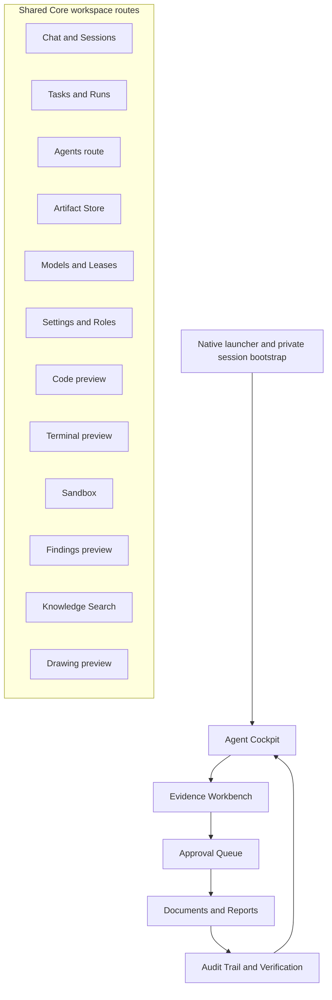

# GUI Information Architecture (PROPOSED)

**Status:** PROPOSED. This is a future information architecture and quality target. The current demo navigation slice is verified separately in the execution checklist; this document does not claim the full workspace is complete.

## Sitemap

The five connected demo views are one curated entry path inside the larger shared Core workspace. The demo must not expose preview routes as if they were finished product surfaces.

## Route registry

| Route | Current view | Proposed role | Industrial demo |
|---|---|---|---|
| `#/chat` | `ChatView` | Conversation and session entry | Hidden |
| `#/tasks` | `TasksView` | Workflow/run queue | Hidden |
| `#/agents` | `CockpitView` (duplicate) | Agent inventory and delegation, if implemented | Hidden; current route is misrouted |
| `#/evidence` | `EvidenceView` | Source evidence and deterministic findings | Visible |
| `#/artifacts` | `ArtifactsView` | Generated and imported artifact catalog | Hidden |
| `#/audit` | `AuditView` | Audit chain and run linkage | Visible |
| `#/models` | `ModelsView` | Provider/model state and lease controls | Hidden |
| `#/settings` | `SettingsView` | Project, policy, role, and retention settings | Hidden |
| `#/cockpit` | `CockpitView` | Current run status and resume entry | Visible; landing route |
| `#/code` | `GenericModuleView` code preview | Code navigation only when editing is connected | Hidden |
| `#/terminal` | `GenericModuleView` terminal preview | Command interaction only when safe execution is connected | Hidden |
| `#/sandbox` | `SandboxView` | Sandbox controls and execution evidence | Hidden |
| `#/findings` | `GenericModuleView` findings preview | Findings overview only when connected | Hidden |
| `#/documents` | `DocumentsView` | Report preview, generation status, download | Visible |
| `#/drawing` | `GenericModuleView` drawing preview | Drawing/diagram inspection when connected | Hidden |
| `#/knowledge` | `KnowledgeView` | Search project-local reference material | Hidden |
| `#/approvals` | `ApprovalsView` | Explicit human review decisions | Visible |

The registry in `src/domain/layout.ts`, activity labels in `ActivityBar.tsx`, route selection in `App.tsx`, and related navigation in `NavigationSidebar.tsx` are the current sources to reconcile. `#/agents` currently resolves to the same `CockpitView` as `#/cockpit`, while `AgentsView` is imported but unused. `code`, `terminal`, `findings`, and `drawing` render explicit preview states in `GenericModuleView`.

## First-run setup wizard

1. **Welcome and scope:** Explain the selected product mode and show whether this is a temporary demo project or an existing workspace.
2. **Project selection:** Resolve and display canonical root, project ID, and service identity. Reject ambiguous or inaccessible roots; never silently switch projects.
3. **Runtime checks:** Test package assets, service, and required separately installed engine. Distinguish “detected” from “tested”; provide the exact missing prerequisite and remediation.
4. **Data policy:** Select a deployment profile and classify allowed inputs. Show where files are stored and whether network egress is permitted. Do not enable hosted use by default.
5. **Provider readiness:** List configured providers and actual probe state. No billable probe or prompt is sent without explicit opt-in and effective policy approval.
6. **Review and finish:** Summarize project identity, profile, model/provider evidence, pending prerequisites, and the first safe next action. Persist only after explicit completion.

Wizard steps can be revisited from Settings. They must not set authorization roles or weaken approval rules; role presets remain presentation choices.

## Navigation rules

- In the Industrial demo, show only Cockpit, Evidence, Approvals, Documents, and Audit. Start at Cockpit. Do not render the More menu, Settings item, or shortcuts to hidden routes.
- Unknown or hidden demo hashes resolve to Cockpit and update the URL to the canonical route. Demo quick links must target visible, connected routes only.
- In the shared workspace, keep every registered route reachable from an accessible navigation item. Remove duplicate routes or give them distinct views before promoting them.
- Label preview routes as previews in both navigation and page content. A route must not claim functionality its current view does not provide.
- Every navigation action preserves the active project/session context and returns focus to the new page heading or tab panel.
- Route permissions are enforced by services. Hiding a navigation item is not access control.

## Performance budgets (proposed)

Measure on the supported Windows test machine with a clean user profile, packaged build, warm OS file cache, and no hosted provider configured. Report P50 and P95 across at least 20 cold app launches and 50 route transitions before adopting these targets as release gates.

| Measurement | Proposed P95 budget |
|---|---:|
| Launcher to interactive shell | 3.0 s |
| First connected demo view | 4.0 s |
| Local route transition after shell load | 150 ms |
| Local health/session readiness result | 1.0 s |
| UI response to a cancellation request | 500 ms to acknowledgement; service completion is separately measured |

Network/provider latency is reported separately from UI responsiveness. Do not mask slow or failed work with a success state or indefinite spinner.

## Accessibility requirements

- Target WCAG 2.2 AA for rendered product surfaces; verify keyboard-only use, visible focus, logical focus order, semantic headings/landmarks, accessible names, status announcements, contrast, and 200% zoom.
- Activity navigation uses a documented keyboard pattern and never relies on color or icon shape alone. Dialogs trap and restore focus; escape behavior is explicit and cannot silently approve or discard work.
- Announce connection, approval, cancellation, and verification changes through a polite live region; announce blocking errors assertively and keep their text available to assistive technology.
- Respect reduced-motion preferences. Provide non-color indicators for engineering verdict and operational status.
- Run automated accessibility checks and manual screen-reader/keyboard review for every newly visible route before release.

## Current code to reuse

`src/gui/src/App.tsx`, `ActivityBar.tsx`, `NavigationSidebar.tsx`, `LayoutContext.tsx`, `RoleOnboardingModal.tsx`, `src/domain/layout.ts`, `src/gui/src/main.tsx`, and the private launcher bootstrap in `desktop/preload.cjs` provide route, layout, onboarding, and session foundations. `tests/release/desktop-browser-rehearsal.cjs` already exercises the five visible demo activity routes and eight related quick links in a real installed Electron renderer. Existing Core routes remain shared; the Industrial demo uses a project-identity mode gate.
